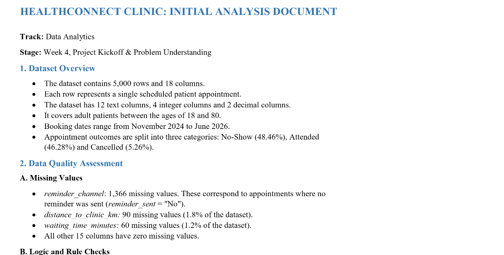

# HealthConnect Clinic Experience Lab

Data Analytics  

Project Kickoff & Problem Understanding

## 📖 Project Overview
HealthConnect Clinic is an outpatient healthcare provider facing operational challenges with patient appointment no-shows. 

The goal of this project is to analyze appointment data, identify factors causing missed visits and provide data-driven insights to improve patient attendance.

## HealthConnect Visualizations

## Week 4 Summary & Tasks Completed
In Week 4, the focus was on understanding the business problem and assessing data quality.

### Key Tasks Completed:
* Loaded and reviewed the dataset of 5,000 appointment records.
* Conducted a thorough data quality and logic assessment.
* Defined 4 key business questions to investigate no-show trends.
* Formulated and justified 4 core KPIs for attendance and reminder performance.
* Documented project assumptions, data limitations and risks.
* Created the initial analysis approach for Week 5.

### Key Initial Findings:
* **High No-Show Rate:** 48.46% of scheduled appointments resulted in a no-show.
* **Reminder Gaps:** 1,366 patients received no appointment reminders.
* **Missing Data:** 90 records are missing distance values and 60 records are missing waiting time values.
* **Data Validity:** All appointment dates, patient ages and historical records passed logic checks.

